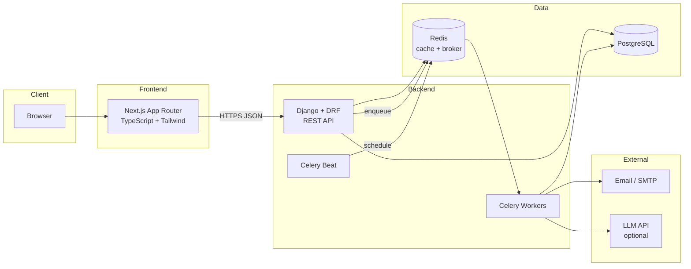
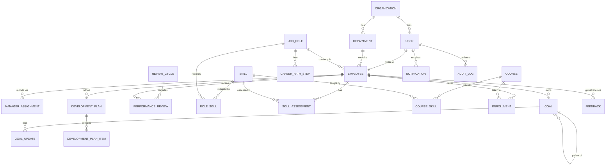
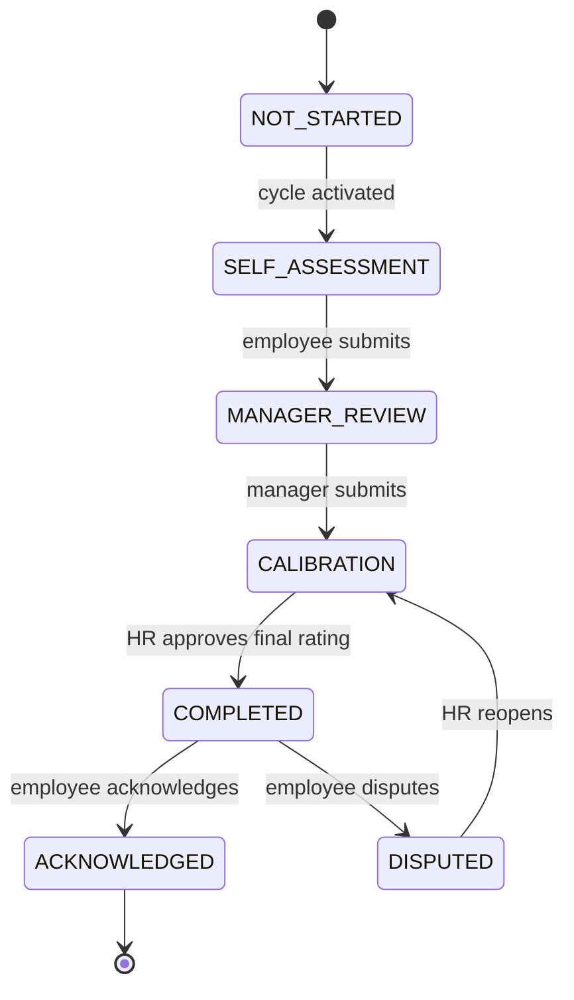

# System Design — Talent Management Platform

> Audience: developers and AI coding agents building the platform.
> Companion docs: `project_description.md`, `backend_agenthandover.md`, `frontend_all_portals_pages_description.md`, `rulesForAntigravity.md`, `phase_wise_prompts.md`.

---

## 1. Goals and Scope

Build a multi-portal HR platform that connects **performance → skills → learning → career growth** in one closed loop.

**In scope (MVP):** auth + RBAC, organizations/departments/employees, goals (KPI/OKR), review cycles and reviews, skills and role requirements, skill assessments and gap analysis, courses and development plans, career paths and readiness, feedback and recognition, notifications, analytics, audit logs.

**Advanced (post-MVP):** AI-assisted summaries and drafts, natural-language HR assistant, SSO, integrations (GitHub/Jira evidence, Slack).

**Out of scope:** payroll, attendance, recruitment/ATS, compensation decisions, automatic promotion/termination decisions.

**Design principles**
1. Modular monolith first. No microservices until a real need appears.
2. Business rules live in the backend service layer. The frontend never computes authoritative scores.
3. Every endpoint enforces permissions server-side.
4. Explainability: any score, gap, or recommendation returns the reasons behind it.
5. Humans decide. AI and rules only suggest.
6. Auditability: sensitive actions are logged immutably.

---

## 2. High-Level Architecture



**Request flow (example: "My Performance" page)**
1. Employee opens `/employee/performance`.
2. Next.js calls `GET /api/v1/goals/?employee=me&cycle=active` with the access token.
3. DRF authenticates the JWT, resolves the tenant (organization) and role, applies object-level permissions.
4. Service/selector layer queries PostgreSQL (scoped by `organization_id`), computes goal scores.
5. JSON returns; TanStack Query caches it and renders the page.

---

## 3. Technology Stack

| Layer | Choice | Notes |
|---|---|---|
| Frontend | Next.js (App Router), TypeScript | Route groups per portal |
| UI | Tailwind CSS + shadcn/ui | One shared design system |
| Data fetching | TanStack Query + typed API client (axios/fetch) | Server state cache |
| Forms | React Hook Form + Zod | Schemas mirror API validation |
| Charts | Recharts | Skill radar, trend lines, bars |
| Backend | Django + Django REST Framework | Modular monolith |
| Auth | `djangorestframework-simplejwt` | Access token (short), refresh (httpOnly cookie) |
| API docs | `drf-spectacular` | OpenAPI at `/api/schema/`, Swagger at `/api/docs/` |
| Filtering | `django-filter` | Declarative list filters |
| Async | Celery + Redis | Broker + result backend |
| Scheduling | Celery Beat (`django-celery-beat`) | Reminders, snapshots |
| Cache | Redis | Analytics aggregates, rate limiting |
| Database | PostgreSQL | Source of truth |
| Containers | Docker + Docker Compose | Dev and prod parity |
| CI | GitHub Actions | Lint, test, build |
| Testing | pytest + pytest-django + factory_boy; Vitest/Jest + Playwright | Unit, API, E2E |

Pin exact versions in `requirements.txt` / `package-lock.json` at project start.

---

## 4. Multi-Tenancy

- Strategy: **shared database, shared schema, `organization` foreign key on every tenant-owned table.**
- A `TenantModel` abstract base adds `organization` and a manager that filters by the current organization.
- The current organization is derived from `request.user.organization`; clients can never send `organization_id` to choose a tenant.
- Unique constraints are scoped per organization (e.g., `(organization, employee_code)`).
- Tests must prove that user A in org 1 cannot read or write org 2 data on every endpoint.

---

## 5. Backend Structure (Modular Monolith)

```
backend/
  config/                # settings (base/dev/prod), urls, celery.py, asgi/wsgi
  apps/
    core/                # TenantModel, base permissions, pagination, exceptions, utils
    accounts/            # User, auth, password flows, MFA hooks
    organizations/       # Organization, Department, settings
    employees/           # Employee, manager history, CSV import
    performance/         # ReviewCycle, Goal, GoalUpdate, PerformanceReview
    skills/              # Skill, JobRole, RoleSkill, SkillAssessment, gap engine
    learning/            # Course, Enrollment, recommendations
    careers/             # CareerPathStep, DevelopmentPlan, readiness engine
    feedback/            # Feedback, Badge, OneOnOne, ActionItem
    notifications/       # Notification, email dispatch, preferences
    analytics/           # Aggregation selectors, cached endpoints, reports
    ai/                  # LLM client, prompt templates, AIRequestLog
    audit/               # AuditLog, middleware/signals
  tests/
```

**Layering inside each app**

```
models.py        # data + invariants only
selectors.py     # read queries (optimized, tenant-scoped)
services.py      # write operations and business rules (transactional)
serializers.py   # validation + representation
permissions.py   # object-level and role-level permission classes
views.py         # thin; call selectors/services
tasks.py         # Celery tasks (thin wrappers around services)
tests/
```

Rule: views never contain business logic; services never touch `request`.

---

## 6. Data Model

### 6.1 Entity Relationship (core)



### 6.2 Table specifications

All tables use UUID primary keys, `created_at`, `updated_at`. Tenant-owned tables include `organization_id`.

**Organization** — `name`, `slug` (unique), `settings` (JSON: rating scale, goal cap, readiness thresholds, review privacy rules).

**User** — `organization`, `email` (unique), `password`, `role` (`HR_ADMIN | MANAGER | EMPLOYEE | EXECUTIVE`), `is_active`, `mfa_enabled`, `last_login`.

**Department** — `organization`, `name`, `parent` (self FK, nullable), `head` (FK Employee, nullable).

**Employee** — `organization`, `user` (1:1), `employee_code` (unique per org), `department`, `current_role` (FK JobRole), `manager` (FK Employee, nullable, denormalized current manager), `joining_date`, `employment_status` (`ACTIVE | ON_LEAVE | EXITED`), `location`, `phone`.

**ManagerAssignment** — `employee`, `manager`, `start_date`, `end_date` (null = current). History table; `Employee.manager` is kept in sync by the service layer.

**Skill** — `organization`, `name`, `category` (`TECHNICAL | SOFT | DOMAIN`), `description`, `is_active`. Unique `(organization, name)`.

**JobRole** — `organization`, `title`, `level` (int), `track` (e.g., Engineering, Design), `department` (nullable), `description`, `min_months_in_role`.

**RoleSkill** — `job_role`, `skill`, `required_level` (1–5), `weight` (1–5), `is_must_have` (bool). Unique `(job_role, skill)`.

**CareerPathStep** — `from_role`, `to_role`, `notes`. Defines allowed next roles.

**SkillAssessment** (append-only history)
`employee`, `skill`, `level` (1–5), `source` (`SELF | MANAGER | ASSESSMENT | CERTIFICATION`), `status` (`PENDING | VALIDATED | REJECTED`), `assessed_by`, `assessed_on`, `evidence_note`, `evidence_url`, `validated_by`, `validated_on`.

**EmployeeSkillCurrent** (derived, maintained by service)
`employee`, `skill`, `self_level`, `validated_level`, `last_validated_on`. Rebuilt whenever an assessment is validated.

**ReviewCycle** — `organization`, `name`, `cycle_type` (`QUARTERLY | HALF_YEARLY | ANNUAL`), `start_date`, `end_date`, `self_assessment_due`, `manager_review_due`, `status` (`DRAFT | ACTIVE | CALIBRATION | CLOSED`).

**Goal**
`organization`, `employee`, `cycle` (nullable), `parent` (self FK, nullable), `title`, `description`, `goal_type` (`KPI | OBJECTIVE | KEY_RESULT`), `metric_unit`, `start_value`, `target_value`, `current_value`, `direction` (`HIGHER_BETTER | LOWER_BETTER`), `weight` (1–10), `due_date`, `status` (`DRAFT | PENDING_APPROVAL | ACTIVE | COMPLETED | CANCELLED`), `approved_by`, `approved_at`.

**GoalUpdate** — `goal`, `value`, `note`, `evidence_url`, `created_by`, `created_at`.

**PerformanceReview**
`organization`, `cycle`, `employee`, `reviewer`, `status` (see 7.2), `self_rating`, `self_comments`, `manager_rating`, `manager_comments`, `calibrated_rating`, `final_rating`, `goal_score_snapshot`, `submitted_at`, `completed_at`, `locked_at`, `acknowledged_at`, `dispute_reason`. Unique `(cycle, employee)`.

**ReviewCompetencyRating** — `review`, `skill` (nullable), `competency_name`, `self_rating`, `manager_rating`, `comment`.

**Course** — `organization`, `title`, `provider`, `url`, `format` (`VIDEO | COURSE | WORKSHOP | BOOK | MENTORING`), `difficulty` (`BEGINNER | INTERMEDIATE | ADVANCED`), `duration_hours`, `is_active`.

**CourseSkill** — `course`, `skill`, `level_from`, `level_to`.

**Enrollment** — `employee`, `course`, `status` (`ENROLLED | IN_PROGRESS | COMPLETED | DROPPED`), `progress_pct`, `assigned_by`, `enrolled_at`, `completed_at`, `certificate_url`.

**DevelopmentPlan** — `employee`, `target_role`, `start_date`, `target_date`, `status` (`DRAFT | PENDING_APPROVAL | ACTIVE | COMPLETED | CANCELLED`), `created_by`, `approved_by`, `generated_by` (`MANUAL | RULES | AI`).

**DevelopmentPlanItem** — `plan`, `item_type` (`COURSE | MENTORING | PROJECT | CERTIFICATION`), `skill`, `course` (nullable), `title`, `due_date`, `status`, `rationale`.

**ReadinessSnapshot** — `employee`, `target_role`, `status` (`DEVELOPING | NEAR_READY | READY_FOR_REVIEW`), `skill_coverage`, `details` (JSON reasons), `calculated_at`.

**Feedback** — `organization`, `from_employee`, `to_employee`, `feedback_type` (`MANAGER | PEER | RECOGNITION`), `visibility` (`PRIVATE_TO_MANAGER | SHARED_WITH_EMPLOYEE | PUBLIC_RECOGNITION`), `content`, `badge` (nullable), `related_review` (nullable).

**Badge** — `organization`, `name`, `description`, `icon`.

**OneOnOne** — `manager`, `employee`, `scheduled_at`, `shared_notes`, `private_notes` (manager-only), `status`. **ActionItem** — `one_on_one`, `owner`, `title`, `due_date`, `status`.

**Notification** — `user`, `notification_type`, `title`, `body`, `link`, `is_read`, `email_status` (`NOT_REQUIRED | PENDING | SENT | FAILED`).

**AuditLog** (append-only) — `organization`, `actor`, `action`, `entity_type`, `entity_id`, `before` (JSON), `after` (JSON), `ip_address`, `user_agent`, `created_at`.

**AIRequestLog** — `organization`, `user`, `feature`, `prompt_hash`, `input_summary`, `output_summary`, `model`, `tokens`, `status`, `created_at`.

### 6.3 Indexing guidelines
- Composite indexes starting with `organization_id` for all list endpoints.
- `(employee_id, cycle_id)` on goals and reviews; `(employee_id, skill_id, assessed_on desc)` on assessments.
- `(user_id, is_read, created_at desc)` on notifications.
- Partial index on `ManagerAssignment(end_date IS NULL)`.

---

## 7. Core Domain Logic

All of this lives in `services.py` and has unit tests with fixed examples.

### 7.1 Goal score

For each goal `i`, normalized score `s_i`:

- `HIGHER_BETTER`: `s = (current − start) / (target − start)`
- `LOWER_BETTER`: `s = (start − current) / (start − target)`
- Clamp to `[0, cap]` where `cap` is an org setting (default `1.0`; allow `1.2` for over-achievement).
- If `target == start`, score is `1.0` when `current` meets the target, else `0`.

Weighted score: `Σ(w_i · s_i) / Σ(w_i)` over goals with status `ACTIVE | COMPLETED` in the cycle. Cancelled goals are excluded. Return per-goal scores so the UI can explain the total.

### 7.2 Review workflow (state machine)



Rules: only the allowed role can make each transition; each transition writes an `AuditLog`; once `COMPLETED`, ratings are immutable except via `DISPUTED → CALIBRATION` by HR; `goal_score_snapshot` is stored when manager submits.

### 7.3 Skill gap

Inputs: employee, target role. Use `validated_level` only by default (org setting `include_self_assessed_provisional` can show self levels as provisional).

Per role skill:
- `gap = max(0, required − validated)`
- `priority = gap × weight` (must-have skills get a tie-break boost)
- `status`: `MET`, `GAP`, `UNVALIDATED` (no validated level yet)

Aggregate: `coverage = Σ(min(validated, required) × weight) / Σ(required × weight)`.

Response includes sorted gaps, coverage, and the list of must-have skills not met.

### 7.4 Career readiness

Status is computed and always returned with reasons:

- **READY_FOR_REVIEW** if all hold: every must-have skill at required validated level; `coverage ≥ ready_threshold` (default 0.85); last two completed cycles have `goal_score ≥ 0.7` and `final_rating ≥ 3`; required courses completed; months in role ≥ `min_months_in_role`.
- **NEAR_READY** if not ready but: ≤ 1 unmet must-have skill (gap ≤ 1) **and** `coverage ≥ 0.70`.
- **DEVELOPING** otherwise.

Thresholds are org-configurable. The status never triggers promotion; it only lets a manager open a promotion review.

### 7.5 Learning recommendations (rule-based)

For each gap skill ordered by priority: select active courses where `CourseSkill.level_to ≥ required` and `level_from ≤ current_level`; rank by (level fit, difficulty match, shorter duration, not already completed). Return `reason` strings such as "Closes System Design gap (2 → 4) for Senior Backend Developer".

### 7.6 Analytics rules
Aggregations never expose individual data to roles that shouldn't see it. Managers see their reporting tree; HR/Executive see org-wide aggregates; small groups (< 5 people) are suppressed or merged in executive views to avoid identifying individuals.

---

## 8. Authentication, Authorization, RBAC

**Auth flow**
1. `POST /auth/login/` → access token (≈15 min) in response body, refresh token in httpOnly secure cookie.
2. Frontend keeps access token in memory; on 401 calls `/auth/refresh/` once, then retries.
3. Logout blacklists the refresh token.
4. Password reset via emailed one-time token (Celery task).
5. MFA (TOTP) hook is reserved; optional for HR Admin.

**Roles:** `HR_ADMIN`, `MANAGER`, `EMPLOYEE`, `EXECUTIVE`. A manager is also an employee for their own data.

### 8.1 Permission matrix

| Resource | Employee | Manager | HR Admin | Executive |
|---|---|---|---|---|
| Own profile | R, limited U | R, limited U | R/U | R |
| Others' profiles | – | R (team) | CRUD (org) | R (summary) |
| Goals | CRUD own drafts; update progress | CRUD/approve for team | R org | R aggregate |
| Reviews | Self part; R own final | Review team; R own | Manage cycles; calibrate; R org | R aggregate |
| Confidential feedback | – | R/W (team) | R (policy) | – |
| Skills library | R | R; propose | CRUD | R |
| Role requirements | R | R | CRUD | R |
| Skill assessments | Create self; R own | Validate team | R org | R aggregate |
| Courses | R; enroll | R; assign | CRUD | R aggregate |
| Development plans | R own; propose items | CRUD for team | R org | R aggregate |
| Analytics | Own only | Team | Org | Org aggregate |
| Audit logs | – | – | R | – |
| Org settings | – | – | CRUD | – |

Implementation: DRF permission classes (`IsHRAdmin`, `IsManagerOfEmployee`, `IsSelfOrManagerOrHR`, …) plus queryset scoping in selectors. Never rely on the UI to hide data.

---

## 9. API Design Conventions

- Base path `/api/v1/`; JSON only; `snake_case` field names end to end.
- IDs are UUIDs; timestamps ISO-8601 UTC; dates `YYYY-MM-DD`.
- Pagination: page-number (`?page=&page_size=`, max 100) returning `{count, next, previous, results}`.
- Filtering/sorting via `django-filter` and `?ordering=`.
- Actions that are not plain CRUD use sub-routes (`POST /goals/{id}/submit/`).
- Error format:

```json
{
  "error": {
    "code": "validation_error",
    "message": "Invalid input.",
    "details": { "target_value": ["Must be greater than start_value."] }
  }
}
```

- Status codes: 200/201/204, 400 validation, 401 unauthenticated, 403 forbidden, 404 not found (also for cross-tenant objects), 409 state conflict, 429 rate limited.
- Idempotency for transitions: repeating a valid transition returns 409 with the current state.
- Throttling: login and password-reset endpoints rate-limited via Redis.

The full endpoint catalog is in `backend_agenthandover.md`.

---

## 10. Asynchronous Processing (Celery + Redis)

**Queues:** `default`, `notifications`, `reports`, `ai`.

| Task | Trigger | Queue |
|---|---|---|
| `send_email_notification` | After notification created | notifications |
| `send_password_reset_email` | Reset request | notifications |
| `notify_cycle_started` | Cycle activated | notifications |
| `send_review_reminders` | Beat: daily 09:00 | notifications |
| `flag_overdue_reviews_and_goals` | Beat: daily | default |
| `recompute_employee_skill_current` | Assessment validated | default |
| `snapshot_readiness` | Beat: weekly + on demand | default |
| `refresh_analytics_cache` | Beat: every 15 min | reports |
| `generate_report_export` | User request (CSV/PDF) | reports |
| `run_ai_summary` | User request | ai |
| `import_employees_csv` | Upload | default |

Rules: tasks are idempotent; use `acks_late`, retry with exponential backoff; tasks call services, not views; heavy report/AI tasks return a job id and the frontend polls `GET /reports/{id}/` or `GET /ai/jobs/{id}/`.

---

## 11. Caching Strategy

- Redis caches analytics aggregates keyed `analytics:{org}:{endpoint}:{filters_hash}` with a 5–15 minute TTL.
- Cache per-role responses separately; never share caches across roles or tenants.
- Do not cache personal data (reviews, feedback) beyond the request.
- Frontend: TanStack Query with sensible `staleTime`; invalidate on mutations.

---

## 12. AI Subsystem (Optional Phase)

- `apps/ai` wraps an LLM provider behind an interface so the provider is swappable.
- The backend **selects and authorizes the data first**, redacts anything not needed (no names where not required), and only then builds the prompt. The LLM never queries the database directly.
- Features: skill-gap summary, draft development plan, review draft from authorized feedback, natural-language analytics Q&A (read-only, mapped to whitelisted selectors, not free-form SQL).
- Every output is a **draft** displayed for human editing and approval; nothing auto-saves into final records.
- All calls are logged in `AIRequestLog`; users see a clear "AI-generated" label.
- Rate limits and per-org opt-in setting. Feature flag `AI_ENABLED`.
- Evaluate for bias: no use of protected attributes in prompts; no scoring of people.

---

## 13. Security and Privacy

- HTTPS everywhere; HSTS, secure cookies, CSRF protection for cookie-based refresh endpoint, strict CORS allow-list.
- Password hashing via Django's default (Argon2 recommended); password policy; account lockout/rate-limit.
- Input validation in serializers; parameterized ORM queries; output escaping on the frontend (no `dangerouslySetInnerHTML` with user content).
- Secrets only from environment/secret manager; never in git.
- Field-level confidentiality for `private_notes` and `PRIVATE_TO_MANAGER` feedback.
- Audit log for: rating changes, review state transitions, permission/role changes, exports, access to confidential data, AI usage.
- Data protection: data minimization, retention policy per org, export/delete flows aligned with applicable privacy law (e.g., India's DPDP Act 2023, GDPR where relevant). Consult legal guidance before production use with real data.
- Backups, least-privilege DB user, dependency scanning in CI.

---

## 14. Observability and Operations

- Structured JSON logs with request id; Sentry (or equivalent) for errors.
- Health endpoints: `/healthz` (liveness), `/readyz` (DB + Redis).
- Celery monitoring via Flower (dev) and task failure alerts.
- Metrics to watch: p95 latency per endpoint, task failure rate, queue length.

---

## 15. Deployment

**Docker Compose services:** `frontend`, `api` (gunicorn), `worker`, `beat`, `postgres`, `redis`, `mailhog` (dev), optional `nginx`.

**Environments:** `dev` (hot reload), `staging`, `prod`. Settings split (`base/dev/prod`).

**Key environment variables**

```
DJANGO_SETTINGS_MODULE=config.settings.dev
SECRET_KEY=
DEBUG=
ALLOWED_HOSTS=
DATABASE_URL=
REDIS_URL=
CELERY_BROKER_URL=
CELERY_RESULT_BACKEND=
EMAIL_HOST= / EMAIL_PORT= / EMAIL_HOST_USER= / EMAIL_HOST_PASSWORD=
CORS_ALLOWED_ORIGINS=
JWT_ACCESS_MINUTES=15
JWT_REFRESH_DAYS=7
AI_ENABLED=false
LLM_API_KEY=
NEXT_PUBLIC_API_BASE_URL=
```

**CI pipeline:** lint (ruff/black, eslint/prettier) → type check (mypy optional, tsc) → backend tests with Postgres/Redis services → frontend tests → build images → (optional) deploy.

---

## 16. Non-Functional Requirements

| Area | Target |
|---|---|
| Performance | List endpoints p95 < 500 ms at 5k employees; dashboards use cached aggregates |
| Availability | Single-region, restart-safe workers |
| Security | OWASP Top 10 review before release |
| Accessibility | WCAG 2.1 AA for core flows |
| Responsiveness | Mobile-friendly employee portal |
| Testability | ≥ 80% coverage on services; every endpoint has permission tests |
| Maintainability | Typed frontend, linted backend, OpenAPI as contract |

---

## 17. Key Decisions and Open Questions

**Decisions made**
- Modular monolith; Celery handles async work.
- Multi-tenant via organization FK.
- Rule-based recommendations first; AI is optional and advisory.
- Validated skills drive gap and readiness; self-assessed levels are shown as provisional.
- `snake_case` API fields; UUID ids; JWT with refresh cookie.

**Open questions (decide before Phase 2)**
1. Rating scale: 1–5 with behavioral anchors (default) or custom per org?
2. Is peer/360 feedback part of the MVP or Phase 2?
3. Should goal approval by manager be mandatory by default?
4. Is SSO needed for the demo?
5. Which role/skill taxonomy seed data will be used?
